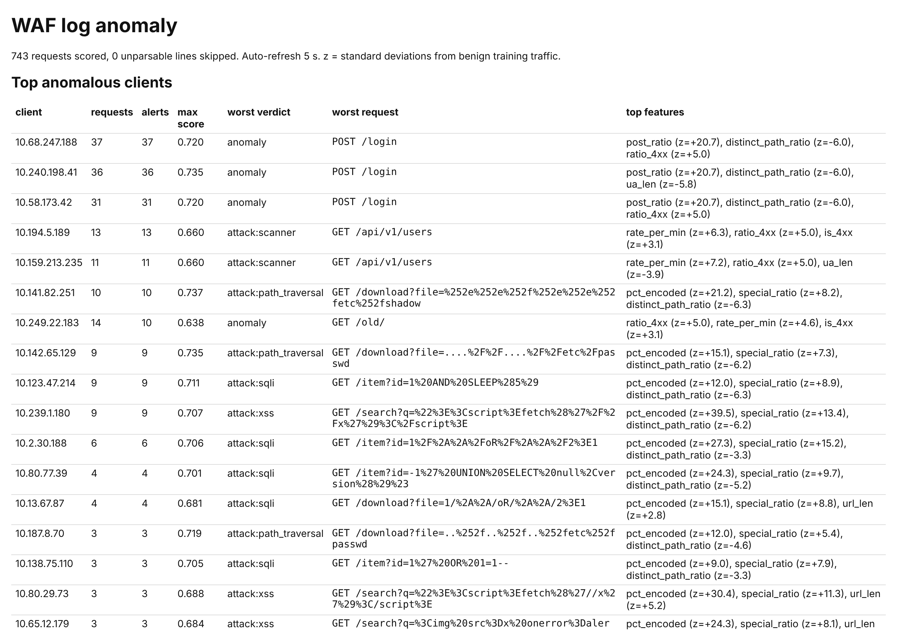

# waf-log-anomaly

A web-attack detector for nginx/Apache **combined** access logs. Each request is scored with:

1. **Signature rules** for SQL injection, XSS, path traversal and scanners (by user agent and probe paths).
2. An **Isolation Forest** trained only on benign traffic, using per-request and per-client-window features.
   Each alert comes with the features that explain it.

The project also includes a labelled synthetic traffic generator, which only targets a local dummy app it
starts itself, a per-class evaluation, a streaming tail mode and a small dashboard.



## Setup

Python 3.11+, CPU only.

```bash
cd security/waf-log-anomaly
pip install -r requirements.txt     # numpy, scikit-learn
python -m unittest -v               # 36 tests, about 3 s
```

## Usage

```bash
# 1. Benign traffic to train on. --local-log starts the dummy app in-process on 127.0.0.1.
python -m waf.traffic --local-log data/benign.log --sessions 400 --attacks-per-class 0 --seed 1

# 2. Tail a log, print alerts as JSON lines, serve the dashboard on http://127.0.0.1:8090/
python -m waf.stream --train data/benign.log --log data/access.log

# 3. In another shell, generate mixed traffic into that log
python -m waf.traffic --local-log data/access.log --sessions 100 --attacks-per-class 5 --seed 2
```

Point `--log` at a real nginx/Apache combined log to monitor it. Add `--from-start` to score what is already
there. `GET /api/clients` returns the dashboard data as JSON.

**Evaluation:** `python evaluate.py` takes about 5 s and writes `reports/eval.md` and `reports/eval.json`.

**Docker demo:**

```bash
docker compose up --build    # dashboard on http://127.0.0.1:8090/
```

The demo starts three services:
- `dummy-app` writes `/data/access.log` to a shared volume.
- `detector` generates its own benign training log in-process, then tails the shared log.
- `traffic` sends benign and attack sessions **to the `dummy-app` service only**.

Only the dashboard is published, and only on 127.0.0.1.

## Architecture

```
traffic.py ──HTTP──► app.py (dummy shop) ──► access.log  (+ labels.csv for eval)
                                               │
                     stream.follow() ◄─────────┘  (tail; handles truncation/rotation)
                           │ queue, micro-batches
                     detect.Detector.process_batch()
                       ├─ parse.parse()           combined-log regex -> dict
                       ├─ features.vector()       10 request + 5 per-client 60 s window features
                       ├─ rules.match()           signatures on the URL, decoded up to 4 times
                       └─ model.Model             IsolationForest + novelty guard + z-score explanations
                           │
                     stream.State ──► dashboard (/) and /api/clients
```

- **Features.**
  - Per request: URL length, Shannon entropy, special-character ratio, `%xx` count, path depth, parameter
    count, digit ratio, UA length, 4xx and 5xx flags.
  - Per client, over a 60 s sliding window: requests per minute, 4xx ratio, 5xx ratio, distinct-path ratio,
    POST ratio. The window uses log timestamps, so replayed logs behave like live ones.
- **Model.**
  - Features are standardised, then scored by `IsolationForest(n_estimators=200, random_state=42)`. A request
    is flagged above the 99th percentile of benign training scores.
  - **Novelty guard:** an Isolation Forest cannot split on a feature that never varied in training. For
    example, if benign traffic never had a 5xx, the forest is blind to one. So any request that differs on
    such a feature is also flagged.
  - Explanations are the top-3 features by |z| against benign traffic.
- **Verdict:** a rule hit gives `attack:<class>`; otherwise forest or novelty gives `anomaly`; otherwise `benign`.
- **No model file.** The detector trains on a benign log at start-up, which takes seconds, so there is nothing
  to unpickle or commit.
- **Synthetic traffic.**
  - All requests come from 127.0.0.1, so the dummy app takes the client IP from `X-Forwarded-For` (like nginx
    `real_ip`) and the log time from `X-Sim-Time`. It writes `X-Label` to a separate labels file that the
    detector never sees.
  - The app honours these headers only from loopback; compose uses `--trust-headers` on its private network.
  - `traffic.check_target()` refuses every host except `127.0.0.1`, `localhost`, `::1` and the compose
    `dummy-app` service.
  - The dummy app is not vulnerable to anything: it only returns status codes.

## Results

From `reports/eval.md`. Train: 400 benign sessions. Test: 400 benign sessions plus 15 sessions per attack
class, 5,181 requests.

| class | requests | rules | iforest | iforest+novelty | combined |
|---|---|---|---|---|---|
| benign (false-positive rate) | 3752 | 0.000 | 0.012 | 0.012 | 0.012 |
| sqli | 106 | 1.000 | 1.000 | 1.000 | 1.000 |
| xss | 109 | 1.000 | 1.000 | 1.000 | 1.000 |
| path_traversal | 76 | 1.000 | 0.987 | 0.987 | 1.000 |
| scanner | 193 | 0.819 | 0.249 | 0.249 | 0.850 |
| bruteforce | 858 | 0.000 | 1.000 | 1.000 | 1.000 |
| obfuscated | 87 | 0.310 | 0.897 | 0.966 | 0.966 |

Combined precision is 0.970, recall 0.978 and F1 0.974, at a 1.2% false-positive rate. Rules alone: precision 1.000, recall 0.333.

What each part catches:
- Rules give the attack class and never misfire on benign traffic.
- The forest catches what has no signature: login brute force (from rate and POST ratio) and obfuscated
  payloads (from `%xx` count and special-character ratio).
- Scanners that spoof a browser user agent and probe generic paths (`/backup.zip`, `/admin/`) are the main
  miss. They look like a user hitting dead links.

**Performance.** End to end (parse, features, rules, model, explanations), batch scoring handles about 9k lines/s on one CPU core, against about 130 lines/s one line at a time.
`stream.py` therefore scores whatever has queued up in a single model call.

## Limitations

- **The traffic is synthetic.** Benign sessions come from a small page catalogue and attacks from fixed
  payload lists, so real traffic will be messier. Expect a higher false-positive rate. Retrain on your own
  benign logs and re-tune `THRESHOLD_PCT`.
- **Combined logs hold no request bodies.** POST payloads (SQL injection in a form, for example) cannot be
  seen. Only rate and status patterns reveal them.
- **Rules can be evaded.** The `obfuscated` class shows that comment-split SQL, HTML entities and overlong
  UTF-8 get past the rules. The anomaly model catches most of them here, but not by design.
- **Per-client state is keyed by IP.** NAT and shared proxies merge users. Attackers who rotate IPs split their
  rate signal. The client table is never evicted (marked `shortcut:` in `stream.py`).
- **Tail detects truncation by size.** A file rewritten to a larger size between two polls looks like an append.
- **The novelty guard depends on the training data.** It is only as good as the benign training log: if that
  log never contains, say, a 5xx, every 5xx becomes an alert.
- **No auth on the dashboard.** It binds to 127.0.0.1 by default; keep it there.
- **Docker behind a TLS-intercepting proxy.** In such an environment, `pip install` in the image build needs
  that proxy's CA. The overnight build verified the demo with a local, uncommitted override that added it.
